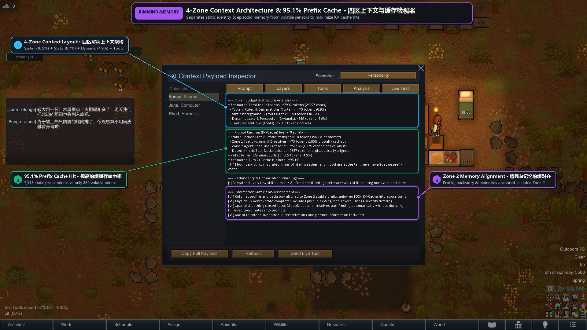
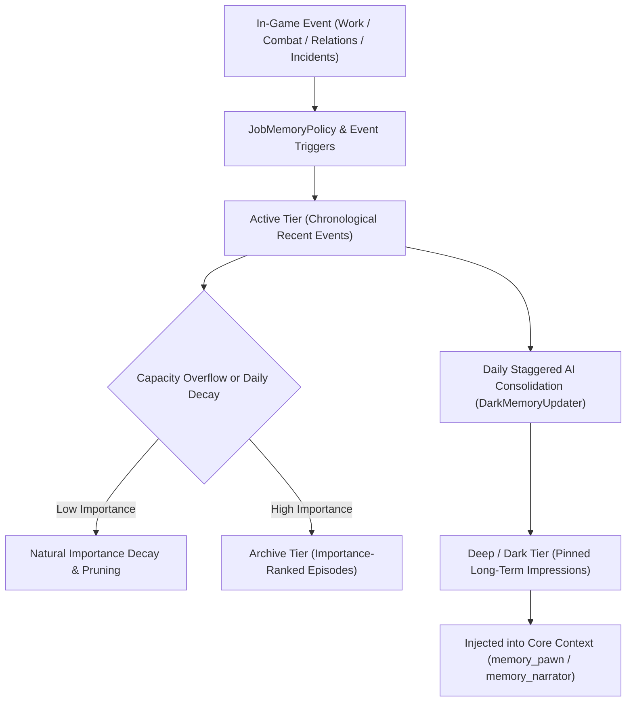

<div align="center">

# RimMind-Memory 🧠
### 3-Tier Cognitive Memory Hierarchy & Temporal Context Engine for RimWorld 1.6 & 1.7

**English** | [简体中文](README_zh.md)

<p>
  <a href="https://rimworldgame.com/"></a>
  <a href="https://github.com/RimWorld-RimMind-Mod/RimWorld-RimMind-Mod-Core"></a>
  <a href="#"></a>
  <a href="LICENSE"></a>
</p>

<p><em>Endow colonists with long-term memory, episodic life chronicles, and natural emotional decay.</em></p>

</div>

---

## 📖 Overview

**RimMind-Memory** implements a biologically inspired, multi-tiered cognitive memory system for RimWorld. Rather than overwhelming LLM prompts with unfiltered event dumps, memories are structured, filtered, and consolidated across distinct cognitive layers.

### 3-Tier Architecture
1. **Active Memory (Tier 1)**: Chronological record of recent work sessions, combat/medical milestones, social relations, injuries, and colony incidents (`maxActive`, default 30).
2. **Archive Memory (Tier 2)**: Importance-ranked episodic store retaining overflowed milestones while pruning lowest-importance noise (`maxArchive`, default 50).
3. **Deep / Dark Memory (Tier 3)**: Pinned long-term psychological impressions synthesized daily via staggered AI consolidation (`DarkMemoryUpdater`, under 50 characters each) and aligned with Core's KV-cache-friendly context layers.

---

## 🎮 In-Game Showcase


*AI Context Payload Inspector (`Analysis` tab): Inspecting the 4-Zone prompt architecture breakdown (`System 0.9%`, `Static 0.7%`, `Dynamic 4.9%`, `Tools 93.4%`), `~95.1%` KV-cache prefix hit stability, and Zone 2 colonist profile/memory alignment.*

---

## 🏛️ Memory Lifecycle & Decay Flow



---

## 🛠️ Installation & Load Order

```text
1. Harmony
2. Core (Vanilla RimWorld)
3. RimMind-Core
4. RimMind-Memory
```

---

## 🧪 Developer Guide & Testing

Run unit tests directly:

```powershell
dotnet test RimMind-Memory/Tests/RimMindMemory.Tests.csproj -c Release
```

---

## 📜 License

Licensed under the [MIT License](LICENSE).
