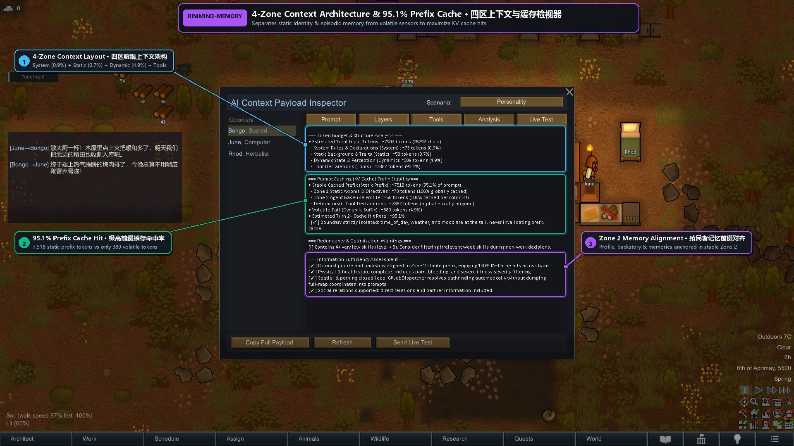
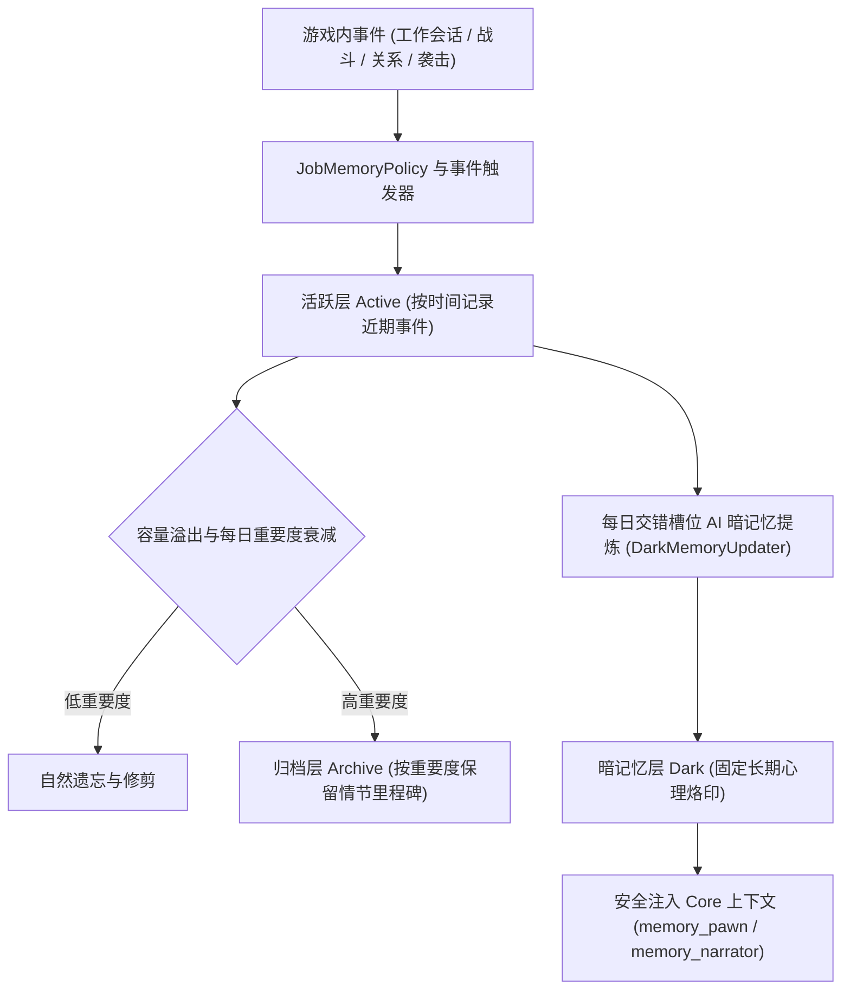

<div align="center">

# RimMind-Memory 🧠
### 专为 RimWorld 1.6 & 1.7 打造的三层认知记忆、情绪衰减与史诗编年史系统

[English](README.md) | **简体中文**

<p>
  <a href="https://rimworldgame.com/"></a>
  <a href="https://github.com/RimWorld-RimMind-Mod/RimWorld-RimMind-Mod-Core"></a>
  <a href="#"></a>
  <a href="LICENSE"></a>
</p>

<p><em>为殖民者赋予长效记忆、跌宕起伏的生命编年史与自然的情绪遗忘曲线。</em></p>

</div>

---

## 📖 模块概览

**RimMind-Memory** 为 RimWorld 引入了受生物认知心理学启发的三层记忆体系。它拒绝将未经清洗的事件全量丢给大模型，而是通过分层聚合、自然遗忘衰减与重点固定，让小人的记忆既丰富又高效。

### 三层记忆架构
1. **活跃记忆（Active 层）**：按时间顺序记录近期工作会话、战斗/医疗节点、社交关系变化、伤病与殖民地重大事件（默认上限 `maxActive=30`）。
2. **归档记忆（Archive 层）**：按重要度排序承接活跃层溢出的情节里程碑，自动淘汰最低重要度的日常噪音（默认上限 `maxArchive=50`）。
3. **暗记忆（Dark 层）**：每日按交错槽位由 AI 提炼（`DarkMemoryUpdater`，每条 ≤50 字）的固定长期心理烙印，与 Core 的前缀缓存上下文层级对齐。

---

## 🎮 实机特性展示


*AI 上下文报文检视器实机（`Analysis` 页签）：直观展示四区提示词解耦结构（`System`、`Static`、`Dynamic`、`Tools`）、高达 `~95.1%` 的静态前缀缓存命中率，以及锚定在 Zone 2 稳定前缀中的殖民者档案与三层记忆。*

---

## 🏛️ 记忆生命周期流转



---

## 🛠️ 安装与加载顺序

```text
1. Harmony
2. Core (RimWorld 原版)
3. RimMind-Core
4. RimMind-Memory
```

---

## 🧪 开发者测试指南

运行单元测试：

```powershell
dotnet test RimMind-Memory/Tests/RimMindMemory.Tests.csproj -c Release
```

---

## 📜 开源协议

本项目采用 [MIT License](LICENSE) 开源许可证。
